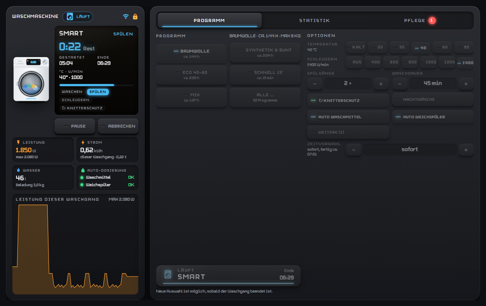

# Washer Card



*Rendered from the card code with example data (no real Home Assistant).*

Lovelace card (`custom:home-twin-waschmaschine-card`) to control and monitor a Haier washing machine (hOn) through the **Washer Control** integration (`washer_control_ha_integration`, domain `washer_control`).

UI language: German.

## Features

- Overview: animated machine graphic, status, programme, remaining time, anti-crease phase
- Control: programme selection with parameters and favourites, delayed start, start / pause / resume / stop (with confirmation)
- Evaluation: wash history and statistics, energy of the machine vs. the smart plug (power / kWh)
- Care: maintenance tasks (every n washes / days), mark done, edit
- Smart plug: shows power, can switch the plug on
- Updates whenever `sensor.<washer>_status` changes; data via WebSocket `washer_control/*`
- Provides `window.HT_WM.svg(...)` for other cards (used by the [Kitchen Appliances Card](https://github.com/SysriX/kitchen_appliances_ha_card))

## Requirements

- [washer_control_ha_integration](https://github.com/SysriX/washer_control_ha_integration) (configured in `configuration.yaml` under `washer_control:`), which builds on an hOn (Haier) custom integration and optionally a smart plug (e.g. Tasmota)
- Styled to match the **Room Tablet** theme (`room_tablet_ha_theme`)

## Installation

### HACS (custom repository)

1. HACS → ⋮ → **Custom repositories** → add `https://github.com/SysriX/washer_ha_card`, category **Dashboard**.
2. Install the card from HACS and reload the browser.
3. HACS registers the resource automatically: `/hacsfiles/washer_ha_card/washer_ha_card.js` (JavaScript module).

### Manual

1. Copy `dist/washer_ha_card.js` to `/config/www/washer_ha_card.js`.
2. Settings → Dashboards → ⋮ → **Resources** → add `/local/washer_ha_card.js` as **JavaScript module**.
3. Reload the browser.

## Configuration

All options are optional.

```yaml
type: custom:home-twin-waschmaschine-card
washer: ku_washer          # washer id from washer_control (default ku_washer – set your own)
titel: Waschmaschine
hintergrund: true          # false = no glass plate (e.g. inside a room-panel frame)
bestaetigen: true          # start/stop only after a second tap
platten: false             # true = every section gets its own glass plate
strom_maschine: sensor.washer_energy   # optional total energy sensor of the machine
                                       # (default: searched on the washer device)
```

### Building blocks for Room Panel

The sections are building blocks for [room_panel_ha_card](https://github.com/SysriX/room_panel_ha_card) (`custom:raum-panel`, rp-extcard bridge): `uebersicht`, `bedienung`, `auswertung`, `pflege` (and `bereiche`, a switcher programme / statistics / care). Put each into its own frame (`card: {…, teil: bedienung}`) or arrange freely (`layout: custom`). All blocks of one machine share data and the programme selection, even as separate instances. Options are editable in the room panel's settings.

The card loads the fonts Rajdhani and Share Tech Mono from Google Fonts.

## Notes

This card was built for the author's own home and tablets. Some defaults (entity ids, dashboard paths) reflect that setup and may need to be set explicitly in your configuration.

## Version

1.2.0

## License

MIT – see [LICENSE](LICENSE).
